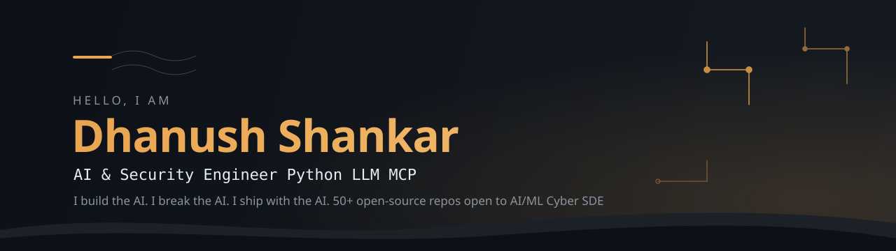

<a href="https://danush-aries.github.io/Danush-Aries/"></a>
<div align="center">

<br />
<a href="https://danush-aries.github.io/Danush-Aries/"></a>
<a href="https://linkedin.com/in/dhanush-shankar-u"></a>
<a href="mailto:danushankar3@gmail.com"></a>
</div>

```python
class Dhanush:
    role = "AI & Security Engineer"
    education = "B.Tech CSE, GITAM University (2026)"
    based_in = "Bengaluru, India"
    builds = ["LLM agents", "MCP tools", "RAG apps", "Full-stack apps"]
    breaks = ["prompt injection", "agent tool hijacking", "leaky system prompts", "supply-chain risk"]
    certified = ["EC-Council EHE", "Cisco Networking & Ethical Hacking"]
    looking_for = "Internships and entry-level roles in AI/ML, cybersecurity or SDE"
```

---

## 🛠️ Build — agents that act in the real world

| Project | What it does | Stack |
|---|---|---|
| **[jarvis](https://github.com/Danush-Aries/jarvis)** | Multi-provider AI assistant with voice, web and CLI versions; runs on local models too |  |
| **[agent-os](https://github.com/Danush-Aries/agent-os)** | Runtime for cooperating agents: scheduler, layered memory, tools, guardrails |  |
| **[computer-use-agent](https://github.com/Danush-Aries/computer-use-agent)** | Claude controlling a sandboxed Linux desktop: screenshot → plan → act |  |
| **[customer-support-agent](https://github.com/Danush-Aries/customer-support-agent)** | Support chat that answers from a knowledge base with RAG and streams replies |  |
| **[promptdiff](https://github.com/Danush-Aries/promptdiff)** | pytest for prompts: catches when a prompt or model change silently breaks outputs | [](https://github.com/Danush-Aries/promptdiff/actions) |
| **[route-arena](https://github.com/Danush-Aries/route-arena)** | Typed LLM router that scores models and picks the right one per request |  |
| **[fullstack-ai](https://github.com/Danush-Aries/fullstack-ai)** | Full-stack AI application with modern frontend and backend integration |  |

---

## 🛡️ Break & defend — security for AI and code

| Project | What it does | Stack |
|---|---|---|
| **[praetor](https://github.com/Danush-Aries/praetor)** | Automated pentest orchestrator: recon → scan → report behind a hard scope gate, with a full audit trail | [](https://github.com/Danush-Aries/praetor/actions) |
| **[prompt-injection-lab](https://github.com/Danush-Aries/prompt-injection-lab)** | Hands-on offline lab: exploit an AI agent, then defend it. No API key needed |  |
| **[mcp-sentinel](https://github.com/Danush-Aries/mcp-sentinel)** | Security linter for MCP configs: tool poisoning, exposed secrets, supply-chain risk |  |
| **[injectsweep](https://github.com/Danush-Aries/injectsweep)** | Finds prompt-injection payloads hidden in documents before they reach a RAG index |  |
| **[tracewarden](https://github.com/Danush-Aries/tracewarden)** | Scans recorded agent tool calls for injection, data exfiltration and RCE patterns |  |
| **[cve-advisor](https://github.com/Danush-Aries/cve-advisor)** | LLM-assisted CVE triage over NVD and Exploit-DB |  |
| **[breachintel](https://github.com/Danush-Aries/breachintel)** | OSINT breach intelligence aggregator — forums, ransomware feeds, geo enrichment |  |

---

## ⚙️ Tech stack

**Languages:** Python, TypeScript, JavaScript, React, Next.js, FastAPI, Node.js, Bash, Git

**AI/ML:** Claude API · Agent SDK · MCP · RAG · Ollama · LangChain · PyTorch · PyMuPDF

**Security:** Burp Suite · Nmap · Metasploit · SAST/SARIF · OWASP LLM Top 10 · MITRE ATT&CK · Sigma

**DevOps:** Docker · Linux · GitHub Actions · PostgreSQL

---

## 📊 GitHub activity


---

## 📫 Let's connect

Hiring for AI or security? I reply fast:

**danushankar3@gmail.com** · [Portfolio terminal](https://danush-aries.github.io/Danush-Aries/)

---

*Last updated: November 2026*
